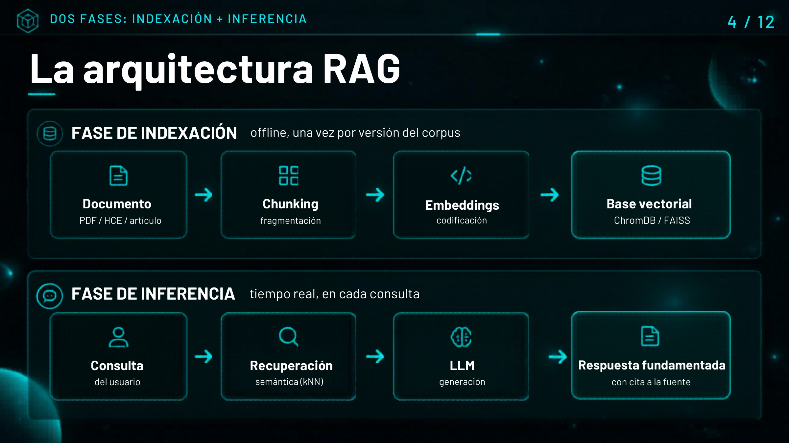

# RAG para historias clínicas y literatura médica

**Prototipo de *Retrieval-Augmented Generation* sobre una guía de práctica clínica, con LangChain, ChromaDB y un LLM local**

*Retrieval-Augmented Generation prototype over a clinical practice guideline (LangChain, ChromaDB, multilingual embeddings and a local LLM with Ollama). Course project, Advanced Programming in Bioinformatics, University of Málaga (2025-26).*

## El problema

Los grandes modelos de lenguaje (LLM) responden con mucha soltura, pero a veces inventan datos que suenan creíbles (las llamadas *alucinaciones*). En una decisión clínica eso no es aceptable.

La técnica RAG reduce este problema: antes de que el modelo responda, se buscan en una fuente fiable los fragmentos de texto relacionados con la pregunta, y el modelo solo puede contestar a partir de ellos. Además, cada respuesta indica de qué páginas sale, así que se puede comprobar.

## Qué hemos hecho

1. **Informe** (`informe/`): estudio de la arquitectura RAG aplicada a la sanidad, sus casos de uso (consultar guías clínicas, analizar historias clínicas electrónicas y apoyar revisiones bibliográficas) y un análisis crítico de sus riesgos: privacidad del paciente, fiabilidad de las fuentes, sesgo en la recuperación y marco regulatorio europeo (RGPD y AI Act).
2. **Prototipo** (`notebook/prototipo_rag.ipynb`): flujo RAG completo sobre la *Guía de Práctica Clínica sobre Diabetes tipo 2* (Osteba, Sistema Nacional de Salud).
3. **Presentación** (`presentacion/`): diapositivas de la exposición en clase.

## Cómo funciona el prototipo




```
PDF de la guía  ->  limpieza del texto  ->  fragmentos de 800 caracteres (solape de 100)
                ->  embeddings multilingües  ->  índice en ChromaDB
pregunta        ->  recuperación MMR (5 fragmentos)  ->  LLM local con Ollama  ->  respuesta con páginas fuente
```

- **Carga y limpieza**: PyPDFLoader y una función de limpieza propia que quita los artefactos típicos de los PDF clínicos (números de página sueltos, cabeceras repetidas, palabras partidas).
- **Embeddings**: `sentence-transformers/paraphrase-multilingual-MiniLM-L12-v2`, que funciona bien en español.
- **Base de datos vectorial**: ChromaDB, con recuperación MMR para que los fragmentos recuperados no sean todos casi iguales.
- **LLM local**: Ollama (por defecto `phi3.5:mini`, que respeta mejor la instrucción de responder solo con el contexto). Al ser local, ningún dato sale del ordenador, algo importante si se trabajara con historias clínicas reales.
- **Demostración**: comparación de las mismas preguntas respondidas con RAG y sin contexto. Sin RAG, el modelo llega a inventar información; con RAG, cita las páginas de la guía.
- **Evaluación**: Precision@5 de la recuperación con un término de referencia por pregunta. Media obtenida: **0,60**. El cuaderno explica su limitación: la guía usa sinónimos clínicos, así que esta métrica puede quedarse corta.

## Cómo ejecutarlo

1. Instala [Ollama](https://ollama.com) y descarga un modelo pequeño: `ollama pull phi3.5:mini`.
2. Descarga el PDF de la guía de práctica clínica sobre diabetes tipo 2 desde la web de GuíaSalud y guárdalo junto al cuaderno como `GPC_429_Diabetes_2_Osteba_resum.pdf`.
3. Abre `notebook/prototipo_rag.ipynb` en Jupyter y ejecuta las celdas en orden. La primera instala las librerías necesarias (LangChain, ChromaDB, sentence-transformers y pypdf).

## Autores

Antonio Sánchez Doña y Aissa Omar El Hammouti Chachoui.
Trabajo de la asignatura Programación Avanzada en Bioinformática del Grado en Ingeniería de la Salud, Universidad de Málaga.
